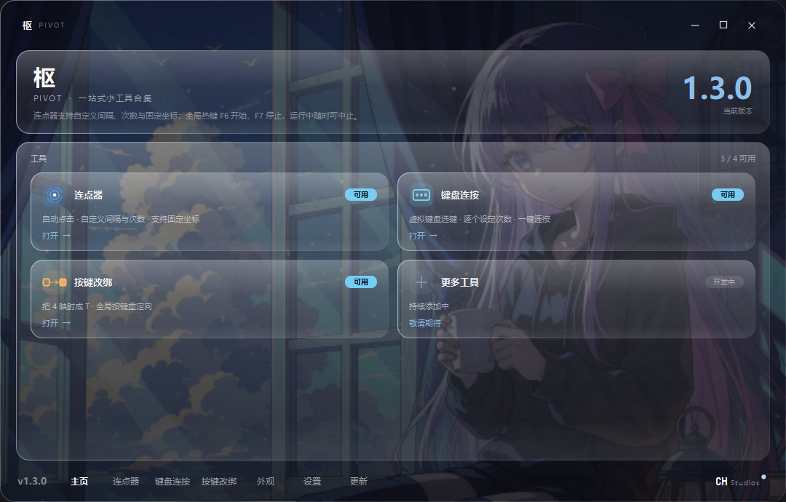
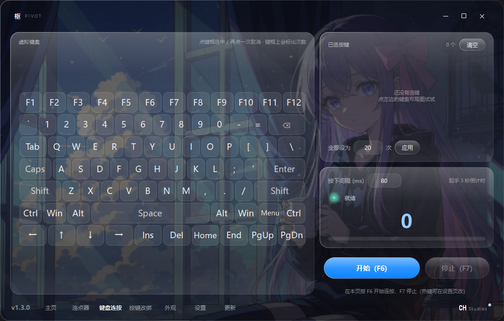
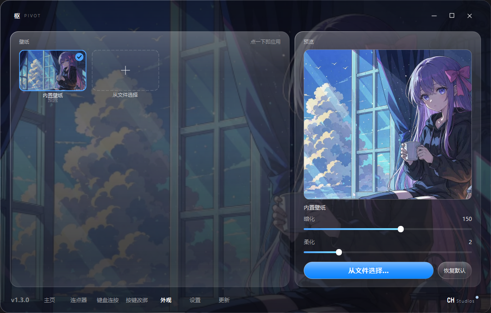

<div align="center">

# Pivot · 枢

**A tiny Windows desktop toolbox**: mouse auto-clicker, keyboard auto-repeat, key remapping.<br>
Dark frosted-glass UI, and every feature is an individual file — delete one, that feature is gone, and the app keeps running.


</div>

<table>
<tr>
<td width="50%"></td>
<td width="50%"></td>
</tr>
<tr>
<td></td>
<td></td>
</tr>
</table>

---

## What it does

| Tool | Description |
|---|---|
| **Auto-clicker** | Left / double / right click, millisecond intervals, fixed position or follow cursor, fixed count or infinite loop. `F6` to start (3-second countdown), `F7` to stop. |
| **Keyboard auto-repeat** | Pick the keys to repeat on an on-screen keyboard; set count and interval per key, and drive several keys at once. |
| **Key remapping** | Map key A to key B globally, with multiple mappings. Press the new key in the recorder, `Esc` to cancel. |
| **Appearance** | Wallpaper, glass opacity and blur strength, animation toggle. Applied live and persisted. |
| **Auto-update** | Silent check in the background at startup, or press "Check for updates". Download → verify SHA256 → replace → restart. |
| **Settings** | Rebind global hotkeys (`F1`–`F24` and combos), failsafe abort, run at startup. |

> **Failsafe**: while clicking, slam the mouse into the top-left corner of the screen to stop instantly (can be disabled in Settings).
> Once disabled there is no way to cancel — use with care.

## Download

Grab the latest build from the **[Releases](https://github.com/CHStudios-X/pivot/releases)** page:

- **Installer** `Pivot_Setup_x.y.z.exe` — recommended. About 35 MB, per-user install to `%LOCALAPPDATA%\Programs\Pivot`, **no administrator rights required**.
  You can tick "run as administrator" during setup; global hotkeys need it.
- **Portable** `Pivot_x.y.z_win64.zip` — unzip and run `pivot.exe`. Writes no registry keys (settings still live in `HKCU\Software\Pivot`).

Requires Windows 10 / 11 (64-bit).

## Run from source

```powershell
git clone https://github.com/CHStudios-X/pivot.git
cd pivot

python -m venv .venv
.\.venv\Scripts\activate
pip install -r requirements.txt

python pivot.py
```

Global hotkeys (the `keyboard` library) need administrator rights. Without them you can still record mappings, but they will not actually fire.

## Build

Requires Python 3.9+; building the installer also needs [Inno Setup 6](https://jrsoftware.org/isinfo.php)
(`winget install --id JRSoftware.InnoSetup`).

```powershell
# Portable build only: dist\pivot\pivot.exe (onedir, with _internal\ and apps\)
.\build.ps1

# Everything: portable + installer + update package
.\build_installer.ps1
```

Output lands in `dist\`:

```
dist\pivot\pivot.exe          portable executable (onedir)
dist\pivot\apps\              externalised feature directory
dist\Pivot_Setup_1.3.0.exe    installer
dist\update\                  update package + version.json
```

> The build scripts **hardcode no absolute paths** — clone anywhere and run.
> They locate `py -3` or `python` on PATH themselves to create the venv.

## Repository layout

```
pivot\
├── pivot.py            shell: window frame, splash, title bar, sidebar, hotkeys, feature loader
├── pivot_kit.py        shared widgets: theme constants, glass panels, buttons, toggles, virtual keyboard
├── updater_core.py     update core: check / download / verify / generate the replace script (Qt-free)
├── apps\               feature modules — one file per feature
│   ├── home.py         home page
│   ├── clicker.py      auto-clicker
│   ├── keys.py         keyboard auto-repeat
│   ├── remap.py        key remapping
│   ├── appearance.py   appearance
│   ├── settings.py     settings
│   └── update.py       update page
├── tests\              assertion-style regression scripts (see below)
├── docs\               license agreement, release guide, screenshots
├── assets\ icon\ lang\ resources
├── build.ps1           PyInstaller packaging
├── build_installer.ps1 one-shot build (calls build.ps1 + ISCC)
├── installer.iss       Inno Setup script
└── make_update.py      builds the update package and version.json
```

## Three design decisions worth mentioning

### 1. Features are files, not toggles

Every `apps\*.py` exports `META` and `Feature`, and the shell scans the directory at startup and loads them dynamically:

```python
META = {
    'id': 'clicker', 'name': '连点器', 'nav': '连点器',   # UI labels are Chinese
    'order': 20, 'icon': 'mouse', 'builder': '_build_clicker',
}
```

Loading has four layers of fault tolerance: file missing → skipped; import error → skipped;
build error → placeholder page; invalid contract → skipped. Any failure affects only that one
feature, and **the shell still starts**.

So to trim the app, just delete files from `apps\`. To add a feature, drop in a new `.py`
(following the contract in `apps\说明.txt`) and it shows up in the sidebar and home page automatically.
Updates will not reinstall features you deleted — the app records them in `_apps_state.json`.

### 2. An executable cannot overwrite itself on Windows

A running exe is locked by the system and the DLLs under `_internal\` are already mapped into memory,
so the main program **cannot modify itself**. The last step of an update therefore is: extract the new
build to a temp directory → generate a `.bat` → spawn it → the main program exits → the script waits for
the process to disappear → `robocopy` over the old files → relaunch → self-delete.

That script has a few traps (`cmd /c` eats the outermost quotes, non-ASCII paths need ANSI encoding,
8.3 short names), all documented in the comments of `updater_core.py`.

### 3. The version number lives in exactly one place

`APP_VER` in `pivot_kit.py` is the single source of truth. `build.ps1` reads it with a regex and passes
it to ISCC as `/DMyAppVersion=`. Keeping the version in two places is the number-one cause of updater
misfires.

## Tests

`tests\` holds assertion-style scripts, not pytest — run each one directly; failures print exactly
which check broke:

```powershell
python tests\_apps_check.py        # feature module contracts (no UI needed)
python tests\_kb_check.py          # keyboard auto-repeat engine
python tests\_remap_ui_check.py    # remap recorder (sends real QKeyEvents)
python tests\_update_check.py      # update pipeline (local HTTP server, two real replace rounds)
```

Run these after building (they launch `dist\pivot\pivot.exe` and assert on screenshots):

```powershell
python tests\_exe_pages_check.py   # page switching + pixel-level stability
python tests\_exe_apps_check.py    # feature removed / added / empty dir / no dir
python tests\_install_test.py      # silent install → verify → uninstall → check leftovers
```

## Known limitations

- **Only tested on Windows 10 / 11.** The acrylic effect on Windows 10 relies on an undocumented API and
  does not apply on some builds; the UI then falls back to an opaque dark theme, with no loss of functionality.
- Dragging the window can drop a few frames with acrylic enabled (a known Windows 10 behaviour).
- The `keyboard` library installs a global hook, so some antivirus products flag it.
- **Automated clicking may violate the terms of service of the target application or game, and may be
  detected by anti-cheat.** Use at your own risk.
- The update source points at this repository's GitHub Releases. See [docs/PUBLISH.md](docs/PUBLISH.md)
  for how to point it somewhere else.

## Contributing

Issues and pull requests are welcome. Before changing code, take a look at `apps\说明.txt` (the feature
module contract) and run `tests\_apps_check.py` to confirm the loading mechanism still works.
See [CONTRIBUTING.md](CONTRIBUTING.md) for details.

## License

[MIT](LICENSE) © 2026 CHStudios

Third-party dependencies keep their own licenses: PySide6 (LGPLv3), pyautogui (BSD-3), keyboard (MIT).
Icons and background images are bundled project assets.
